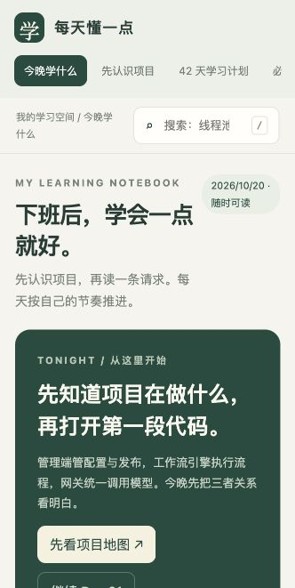

# 每天懂一点 · 我的后端学习手册

本地、离线可用的 Java / AI 平台后端学习页面，入口为 **index.html**。

## 换电脑接着学

先打开 [学习接续.html](学习接续.html)，里面保存最近一次学习位置、已理解与待验证的内容、下一步任务，以及发给另一台电脑 Codex 的接续指令。家里先在仓库目录运行 `git pull --ff-only`，再让 Codex 读取此文件即可。它恢复的是学习上下文，不是完整聊天记录。浏览器内的笔记、勾选和收藏仍按下文导出／导入。

## 手机背诵文档

[下载 Java 后端必备八股文手机背诵版（Word）](手机背诵/Java后端必备八股文手机背诵版.docx)

共 110 题、10 个主题，采用 A5 单栏排版，包含章节跳转、白话理解、背诵答案、例子、易错点和追问。下载后用手机 Word 或 WPS 打开；建议每天新学 3 题、复习 5 题，遮住答案复述。

## 在家里电脑打开

1. 在 GitHub 仓库页面选择 **Code → Download ZIP**，下载后解压。
2. 在解压目录中双击 **index.html**，用浏览器打开。不要直接在 GitHub 文件页面阅读 HTML 源码。
3. 从“先认识项目”开始，再按“今晚学什么”和“42 天学习计划”推进。

也可以使用 Git：

```sh
git clone https://github.com/lvpin1120-maker/my.git
```

以后在仓库目录运行 `git pull` 获取更新。仅阅读无需安装 Python、Node.js 或启动服务。

## 家里电脑也需要推送时

Git 克隆会取得学习资料和源码，**不会取得公司电脑钥匙串里的凭证**。不要把 PAT 写进仓库、远端 URL 或提交历史。

只阅读这个公开仓库无需 PAT。如果家里也要推送，在家里电脑终端进入克隆目录，运行一次：

```sh
python3 setup-credentials.py
```

Windows 安装 Python 后也可以运行 `py setup-credentials.py`。按提示输入 GitHub 用户名和 PAT，令牌输入会隐藏。脚本在 macOS 使用钥匙串，在其他系统优先使用已安装的 Git Credential Manager，或可用的 libsecret；没有安全凭证管理器时会停止，不退回明文存储。

可在不同电脑分别安全配置同一个仍有效且有此仓库权限的 PAT；每台电脑需配置一次。此脚本仅修改当前仓库的本地 Git 配置，并按仓库路径匹配凭证。以后正常执行 `git push`，由本机系统凭证管理器提供认证。更换或撤销令牌后，需要更新各电脑保存的凭证。

## 内容

- 管理端、工作流执行引擎、大模型网关的项目地图与重点接口。
- 42 天学习计划，每天包含源码入口、练习、验收与最低任务。
- 110 个知识点：白话解释、面试回答、例子、常见错误、追问。
- 16 道基础自测题，以及搜索、自评、收藏、学习笔记。

## 换电脑继续学习

学习进度和笔记保存在各自浏览器的本地存储中，**不会因为推送或拉取 Git 仓库而自动同步**。

1. 离开公司前，在“我的学习记录”中点击“导出学习记录”。
2. 将导出的 JSON 文件带到家里，在同一页面点击“导入记录 · 合并”。
3. 回公司时可以反向操作。合并遇到相同条目时，导入记录覆盖该条目，建议使用最新导出文件。

切换浏览器、移动页面文件位置或清理浏览数据前，也建议先导出备份。

源码阅读按钮记录的是公司电脑上的参考路径；家里没有对应业务项目时仍可阅读全部学习内容，这些按钮不会下载公司项目源码。

## 维护页面

内容与模板位于 study-center/。修改后使用 Python 3 构建：

```sh
python3 study-center/build.py
```

构建只依赖标准库，生成根目录 index.html。将源文件和生成的 index.html 一并提交。


